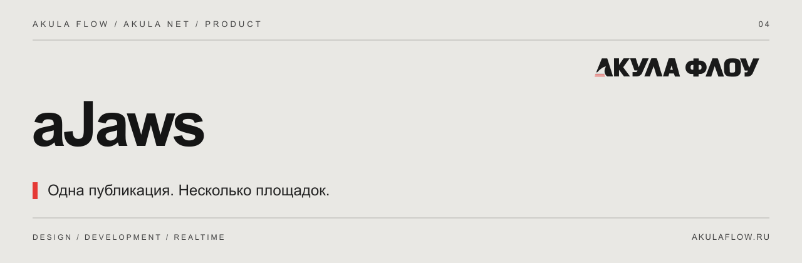

[Сайт](https://akulaflow.ru/) · [GitHub](https://github.com/yanakulov/ajaws) · [GitVerse](https://gitverse.ru/yanakulov/ajaws) · [Changelog](CHANGELOG.md)

# aJaws · Пасть Акулы

**Кросспостинг и расписание публикаций для Telegram и VK.**

Часть экосистемы [Akula Net](https://github.com/yanakulov/anet) от [Акулы Флоу](https://akulaflow.ru/). Работает с общей авторизацией и пользователями aNet.

## Возможности

- Подключённые аккаунты и площадки.
- Публикации, медиа, очередь и расписание.
- Telegram через серверный TDLib.
- VK через OAuth/PKCE.
- История попыток отправки и проверка лицензии перед публикацией.

## Подключение

Подключаемый модуль aNet. ID лицензии: `crossposting`. Реальные отправки требуют настроенных провайдеров и подключённых аккаунтов.

Для работы требуется aCore и серверное разрешение на модуль.

## Версия

Описание соответствует текущей aNet **1.0.0**. Отдельная версия aJaws не заявляется. Совместимые пакеты AF — **0.2.0**.

## Другие части экосистемы

[aCore](https://github.com/yanakulov/acore) · [aVision](https://github.com/yanakulov/avision) · [aFlow](https://github.com/yanakulov/aflow) · [aSense](https://github.com/yanakulov/asense)

## О репозитории

Это публичный информационный репозиторий: описание продукта и журнал изменений. Исходники развиваются в приватных репозиториях. Публикация описания не предоставляет лицензию на программное обеспечение.

Сайт и связь со студией: [akulaflow.ru](https://akulaflow.ru/).
